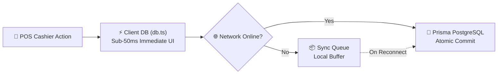
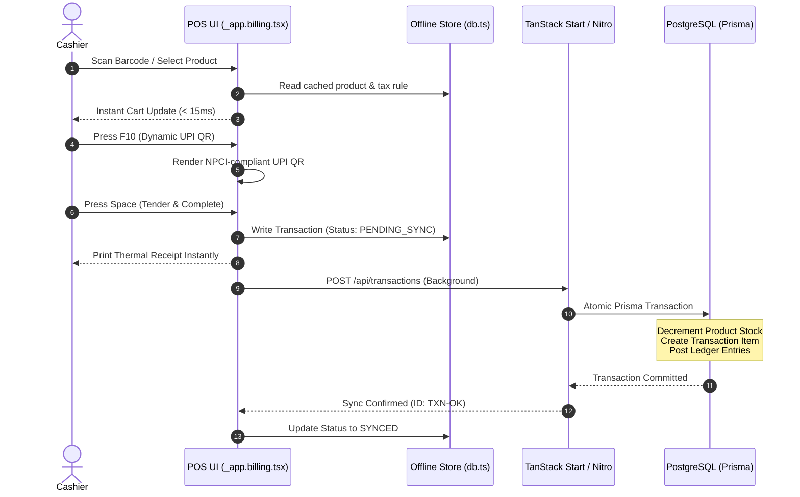

# 🏛️ Bizora Owner OS — Full-Stack Architecture & Engineering Guide
> **Enterprise Autonomous Retail Operating System, High-Velocity POS & Real-Time Decision Intelligence**

---

## 📑 Table of Contents
1. [Architecture Overview](#1-architecture-overview)
2. [Frontend Architecture & TanStack Router](#2-frontend-architecture--tanstack-router)
3. [Dual-Write POS Engine & Offline-First Shield](#3-dual-write-pos-engine--offline-first-shield)
4. [Dual-Database Architecture (PostgreSQL + MongoDB)](#4-dual-database-architecture)
5. [End-to-End POS Transaction & Sync Flow](#5-end-to-end-pos-transaction--sync-flow)
6. [Dynamic 0% MDR UPI QR & Payment Engine](#6-dynamic-0-mdr-upi-qr--payment-engine)
7. [AI & Autonomous Decision Intelligence Engine](#7-ai--autonomous-decision-intelligence-engine)
8. [Cybersecurity & Data Isolation Perimeter](#8-cybersecurity--data-isolation-perimeter)
9. [Core Team & Engineering Collaborators](#9-core-team--engineering-collaborators)

---

## 1. Architecture Overview

**Bizora Owner OS** is built as a high-performance, single-application full-stack architecture powered by **React 19**, **TanStack Start**, **Vite 8**, **Tailwind CSS v4**, and **Prisma ORM with PostgreSQL**.

```
fieldproject/
├── prisma/                        # 🗄️ Database schema & migrations
│   └── schema.prisma              # Complete PostgreSQL domain models
├── public/                        # 🌐 Static assets & audio notifications
├── scripts/                       # ⚙️ Production build & deployment scripts
│   └── build.js                   # SSR Nitro & static build bundler
├── src/                           # 💻 Application source code
│   ├── components/                # Reusable UI primitives, badges, drawers
│   ├── lib/                       # POS offline cache, API client, auth, contexts
│   └── routes/                    # Type-safe file-based TanStack routes
├── components.json                # Shadcn design system config
├── package.json                   # Dependencies & build scripts
├── tsconfig.json                  # TypeScript compiler options
└── vite.config.ts                 # Vite bundler plugins & aliases
```

---

## 2. Frontend Architecture & TanStack Router

The application leverages **TanStack Router & Start** to deliver type-safe, code-split, and instant client-side routing.

### Core Routing Structure (`src/routes/`):
* `__root.tsx`: Top-level application context provider, toast containers, and global error boundaries.
* `_app.tsx`: Authenticated application shell with responsive sidebar, quick-search (Cmd+K), and 360 drawers.
* `_app.billing.tsx`: Real-time barcode scanning POS counter with live total calculations and split payments.
* `_app.products.tsx`: Product catalogue with batch numbering, cost/selling price tracking, and OCR scanning.
* `_app.inventory.tsx`: Stocktake logs, minimum threshold warnings, and inventory valuation metrics.
* `_app.accounts.tsx`: General ledger, balance sheet, automated debit/credit reconciliations, and cash drawers.
* `_app.sales.tsx`: Analytical dashboards showing revenue, gross margin, basket size, and order volume.
* `_app.ai-decisions.tsx`: AI recommendation cards for dynamic price markdowns, dead stock clearance, and reorder levels.
* `_app.logistics.tsx`: Local delivery order dispatching and doorstep 4-digit OTP verification.

---

## 3. Dual-Write POS Engine & Offline-First Shield

### The Offline Problem in High-Velocity Retail
During peak checkout hours, physical retail cashiers process 1 item every 2 seconds. Any network jitter or 1,500ms API roundtrip creates bottlenecks at the counter. If the internet drops, retail stores come to an immediate halt.

### Bizora's Dual-Write Solution:
1. **Immediate Local Commit (< 50ms)**: When the cashier scans an item or completes a sale, the record is immediately committed to client indexed storage (`src/lib/db.ts`).
2. **Asynchronous Background Sync**: An atomic payload is dispatched to PostgreSQL via Prisma.
3. **Queue Reconciliation**: If the network is unavailable, transactions accumulate safely in the client sync queue. As soon as the browser detects network restoration, the queue flushes transactions in sequence with idempotency tokens.



---

## 4. Dual-Database Architecture

Bizora combines relational and document storage for maximum performance and compliance:

1. **PostgreSQL (via Prisma ORM & PgBouncer)**:
   - Manages structured relational data requiring strict transactional guarantees (`ACID`).
   - Models: `Workspace`, `User`, `Product`, `Transaction`, `TransactionItem`, `InventoryStock`, `LedgerAccount`, `LedgerEntry`.
   - Partitioned by `workspaceId` on every query to enforce multi-tenant isolation.

2. **MongoDB Atlas**:
   - High-throughput ingestion of unstructured audit logs, POS hardware telemetry, and cashier event streams.
   - Preserves append-only audit trails without bloating relational indexes.

---

## 5. End-to-End POS Transaction & Sync Flow



---

## 6. Dynamic 0% MDR UPI QR & Payment Engine

Rather than forcing merchants to pay 2%–3% gateway fees to payment aggregators:
* Bizora dynamically formats the standard National Payments Corporation of India (NPCI) URI:
  $$\text{upi://pay?pa=store.bizora@okaxis\&pn=StoreName\&am=TotalAmount\&cu=INR\&tn=InvoiceID}$$
* The cashier's secondary display or the customer-facing tablet displays the generated SVG QR.
* Direct bank-to-bank settlement occurs with **0% gateway deductions**.

---

## 7. AI & Autonomous Decision Intelligence Engine

* **Automated Reordering**: Continuously analyzes historical sales velocity, supplier delivery lead times, and safety stock levels to calculate economic order quantities (EOQ).
* **Dead Stock Liquidation**: Flags items unsold for > 45 days and suggests targeted discount bundles.
* **Inbound Voice AI (Vapi)**: Handles incoming customer phone calls, verifies product availability, and creates pending delivery orders.

---

## 8. Cybersecurity & Data Isolation Perimeter

* **Workspace Partitioning**: All data operations enforce tenant boundaries via Prisma extensions.
* **Zero Hardcoded Secrets**: Production secrets and database URIs are delivered strictly via environment configurations.
* **Honeypot Protection**: Authentication forms include hidden fields to block bot abuse.

---

## 9. Core Team & Engineering Collaborators

* **Om Khade** ([@omkhade75](https://github.com/omkhade75)) — Lead Architect & Creator  
* **Priyansh Dewan** ([@priyanshdewan](https://github.com/priyanshdewan)) — Core Contributor & Full-Stack Engineer  
